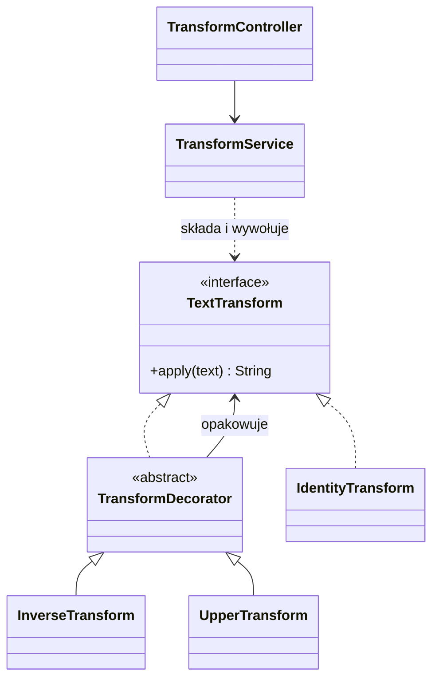

# Text Transformer

## Wprowadzenie

Text Transformer to projekt aplikacji dla osób pracujących z danymi tekstowymi. W podstawowym wariancie aplikacja odwraca kolejność znaków w podanym tekście, zamienia litery na wielkie i zwraca wynik. Po wpisaniu `mirek` użytkownik otrzyma `KERIM`. Operacja będzie dostępna w interfejsie graficznym (GUI) oraz przez zdalne API, które pozwoli korzystać z niej w innych narzędziach.

## Procesy biznesowe

<a id="bc1"></a>
### BC1 — Transformacja tekstu

**Aktorzy**

[Użytkownik](#ac1), [Klient API](#ac2)

**Scenariusz główny**

1. Użytkownik podaje tekst w interfejsie graficznym i uruchamia transformację. ([UC1](#uc1))
2. System odwraca kolejność znaków i zamienia litery na wielkie. ([BR1](#br1), [BR2](#br2))
3. Użytkownik otrzymuje wynik w interfejsie graficznym.

**Scenariusz alternatywny**

1.A. Klient API przesyła tekst w żądaniu do zdalnego API. ([UC2](#uc2))

- 1.A.1. System wykonuje transformację zgodnie z krokiem 2.
- 1.A.2. Klient API otrzymuje wynik w odpowiedzi na żądanie.

## Aktorzy

<a id="ac1"></a>
### AC1 — Użytkownik

Osoba, która przekształca tekst za pomocą interfejsu graficznego aplikacji.

<a id="ac2"></a>
### AC2 — Klient API

Zewnętrzna aplikacja lub skrypt, który przesyła tekst do zdalnego API i odbiera wynik transformacji.

## Przypadki użycia poziomu użytkownika

### Aktorzy i ich cele

| Aktor | Cel |
| --- | --- |
| [Użytkownik](#ac1) | [UC1](#uc1) — Przekształcenie tekstu w interfejsie graficznym |
| [Klient API](#ac2) | [UC2](#uc2) — Przekształcenie tekstu przez zdalne API |

<a id="uc1"></a>
### UC1 — Przekształcenie tekstu w interfejsie graficznym

**Aktor**

[Użytkownik](#ac1)

**Scenariusz główny**

1. Użytkownik wpisuje lub wkleja tekst do pola wejściowego.
2. Użytkownik uruchamia transformację.
3. System odwraca kolejność znaków i zamienia litery na wielkie. ([BR1](#br1), [BR2](#br2))
4. System wyświetla przekształcony tekst w polu wyniku.

<a id="uc2"></a>
### UC2 — Przekształcenie tekstu przez zdalne API

**Aktor**

[Klient API](#ac2)

**Scenariusz główny**

1. Klient API wysyła żądanie zawierające tekst wejściowy.
2. System odczytuje tekst z żądania, odwraca kolejność znaków i zamienia litery na wielkie. ([BR1](#br1), [BR2](#br2))
3. System zwraca przekształcony tekst w odpowiedzi na żądanie.

## Obiekty biznesowe

### BO1 — Tekst wejściowy

Ciąg znaków podany przez użytkownika lub przesłany przez klienta API.

### BO2 — Tekst wynikowy

Ciąg znaków utworzony w wyniku transformacji tekstu wejściowego.

## Reguły biznesowe

<a id="br1"></a>
### BR1 — Odwrócenie kolejności znaków

System odwraca kolejność znaków w całym tekście wejściowym. Obejmuje to również spacje, cyfry i znaki interpunkcyjne. Po tym kroku tekst `mirek` ma postać `kerim`.

<a id="br2"></a>
### BR2 — Zamiana liter na wielkie

System zamienia małe litery w odwróconym tekście na odpowiadające im wielkie litery. W ten sposób z `kerim` powstaje `KERIM`.

| Tekst wejściowy | Tekst wynikowy |
| --- | --- |
| `mirek` | `KERIM` |
| `Ala ma kota!` | `!ATOK AM ALA` |
| `żółć` | `ĆŁÓŻ` |

## Macierz CRUDL

| Przypadek użycia | BO1 — Tekst wejściowy | BO2 — Tekst wynikowy |
| --- | --- | --- |
| UC1 — Przekształcenie tekstu w interfejsie graficznym | R | C |
| UC2 — Przekształcenie tekstu przez zdalne API | R | C |

`R` oznacza odczyt otrzymanego tekstu, a `C` oznacza utworzenie wyniku w ramach pojedynczej operacji.

## Proponowana architektura

GUI i aplikacje zewnętrzne wywołują REST API przez HTTP. Kontroler odczytuje dane z żądania i przekazuje tekst do wspólnego modułu transformacji. Każde żądanie zawiera dane potrzebne do wykonania operacji. Proponowany stos serwera to Java, Spring Boot i Maven, zgodnie z przykładem ze slajdów 8–15 prezentacji *Planowanie Sprintu-2023*.

### Proponowany kontrakt REST API

Klient wysyła `POST /transform` z tekstem wejściowym w formacie JSON (UTF-8).

```json
{ "text": "mirek" }
```

Serwer zwraca `200 OK` oraz wynik w formacie JSON.

```json
{ "result": "KERIM" }
```

Jeśli brakuje pola `text` lub jego wartość nie jest ciągiem znaków, serwer zwraca `400 Bad Request`.

### Wzorzec Dekorator

Moduł transformacji buduje w czasie wykonania łańcuch dekoratorów według domyślnej sekwencji `inverse`, `upper`. Każdy dekorator implementuje interfejs `TextTransform`, najpierw wywołuje opakowaną transformację, a następnie wykonuje własny krok. `UpperTransform` opakowuje `InverseTransform`, który opakowuje `IdentityTransform` zwracający tekst wejściowy. W rezultacie zamiana liter na wielkie następuje po odwróceniu tekstu.



## Plan Sprintu 1

### Proponowany cel sprintu

Użytkownik może podać tekst w GUI lub przesłać go do zdalnego API i w obu przypadkach otrzymać wynik odwrócenia tekstu oraz zamiany liter na wielkie. Główny przykład odbioru to `mirek` → `KERIM` w obu kanałach.

### Rejestr produktu

| ID | Element | Kryterium akceptacji | Proponowany termin |
| --- | --- | --- | --- |
| PB1 | Domyślna transformacja tekstu | Moduł wykonuje `inverse`, a potem `upper`. Zwraca `KERIM` dla `mirek`, `!ATOK AM ALA` dla `Ala ma kota!` i `ĆŁÓŻ` dla `żółć`. | Sprint 1 |
| PB2 | Transformacja w GUI ([UC1](#uc1)) | Po wpisaniu `mirek` i uruchomieniu transformacji GUI wyświetla `KERIM`. | Sprint 1 |
| PB3 | Transformacja przez REST API ([UC2](#uc2)) | Żądanie z tekstem `mirek` zwraca `200 OK` i wynik `KERIM` w JSON. Żądanie z nieprawidłowym polem `text` zwraca `400 Bad Request`. | Sprint 1 |
| PB4 | Wybór transformacji i ich kolejności | Użytkownik może uruchomić jedną operację albo wybrać ich kolejność. Klient API przekazuje w JSON tekst oraz listę nazw operacji. System wykonuje operacje w podanej kolejności. | Do uzgodnienia |
| PB5 | Rozszerzenie zestawu operacji | `upper` zmienia litery na wielkie, `lower` na małe, a `capitalize` ustawia pierwszą literę każdego wyrazu jako wielką. Samodzielne `inverse` odwraca znaki, zachowując wzorzec wielkości liter na pozycjach, np. `MirEk` → `KerIm`. | Do uzgodnienia |

Slajd 19 podaje szersze kryteria dla sekwencji i API. Pełny odbiór tych elementów według prezentacji wymaga również PB4, czyli obsługi pojedynczej operacji i dowolnej kolejności dostępnych operacji.

### Rejestr sprintu

| Element | Zadania |
| --- | --- |
| PB1 | Utworzyć wspólny interfejs i dekoratory. Złożyć domyślną sekwencję i sprawdzić przykłady z reguł biznesowych. |
| PB2 | Dodać pole tekstowe, uruchomienie transformacji i pole wyniku. Zweryfikować scenariusz w GUI. |
| PB3 | Zaimplementować endpoint i obsługę błędnych danych. Sprawdzić odpowiedzi `200` i `400` oraz zgodność wyniku z GUI. |
| Przygotowanie inkrementu | Skonfigurować repozytorium i CI, przygotować dokumentację techniczną oraz oznaczyć wersję zgodnie z DoD. |

Zespół ustala pojemność sprintu na podstawie swojej dostępności, szacuje zadania i uzgadnia zakres z prowadzącym w roli Product Ownera.

### Definition of Done (DoD)

#### Minimalne kryteria ze slajdu 20

- Kod znajduje się w repozytorium na GitHubie, do którego prowadzący ma dostęp. Repozytorium zawiera tag inkrementu zgodny z wersją w `pom.xml`.
- Automatyczne budowanie kompiluje aplikację i tworzy paczkę do dystrybucji. CI uruchamia budowanie po zmianach w repozytorium, a prowadzący ma dostęp do środowiska CI.
- Budowanie generuje dokumentację techniczną. Co najmniej jedna klasa lub interfejs ma pełną dokumentację, np. Javadoc.
- Rejestr produktu i rejestr sprintu znajdują się w narzędziu dostępnym dla prowadzącego, np. GitHub Projects lub Trello.
- Implementacja wykorzystuje Dekorator do dynamicznego składania obiektu transformującego.

Slajd 20 przyznaje dodatkowe punkty m.in. za diagram klas UML, logowanie przez SLF4J oraz, w zespołach co najmniej pięcioosobowych, diagram sekwencji obsługi żądania REST. Zasady punktowania rejestrów i wartości biznesowej inkrementu są na slajdzie 21.
